<p align="center">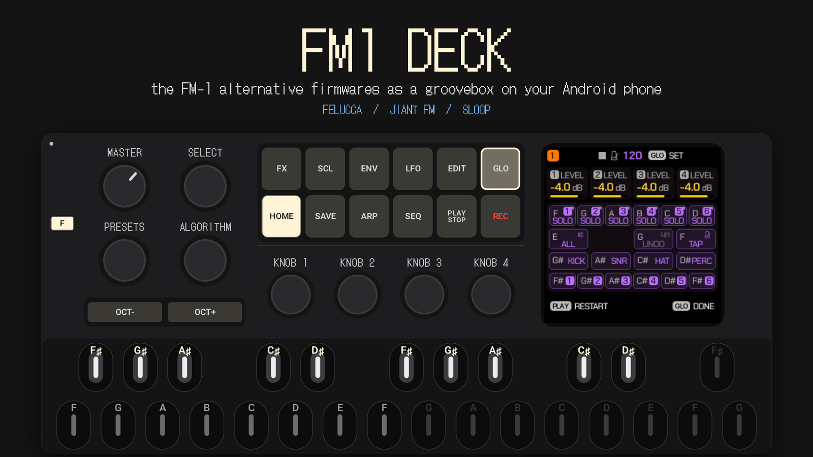</p>

<p align="center">
<a href="LICENSE"></a>


</p>

<p align="center">
<b><a href="../../releases">Download the APK</a></b> ·
<b><a href="docs/MANUAL.md">Manual</a></b> ·
<b><a href="CHANGELOG.md">Changelog</a></b> ·
<b><a href="docs/HOW-IT-WORKS.md">How it works</a></b>
</p>

---

**FM1 DECK** puts the community firmwares of the **FM-1** pocket FM synthesizer —
[Felucca](https://github.com/hugelton/Felucca), [JIANT FM](https://github.com/juanjiant-bit/JIANT) and
[SLOOP](https://github.com/isod89/sloop-fm1) — on an Android phone, as a real groovebox you play with your fingers.

It is not a remake and not an imitation. The authors' own C code runs on the phone, unmodified: the same
sequencer, the same engines, the same screens, the same button combos. FM1 DECK gives it a body — a touch panel
with the original controls, a low-latency audio engine, a master bus, and a Wi-Fi link to jam with other phones.

> **Status: preview.** Built and tested on a Samsung Galaxy M52 5G and a POCO C75. Features marked *planned* are
> on the [roadmap](#roadmap), not in the app yet.

## See it play

| | |
|---|---|
| [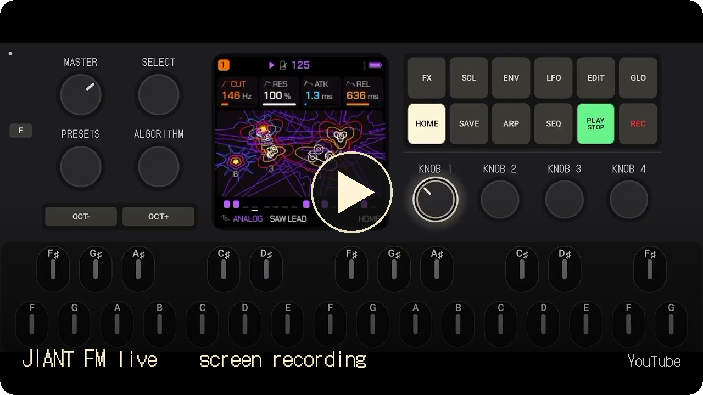](https://youtu.be/nUwRVQZXRtA) | [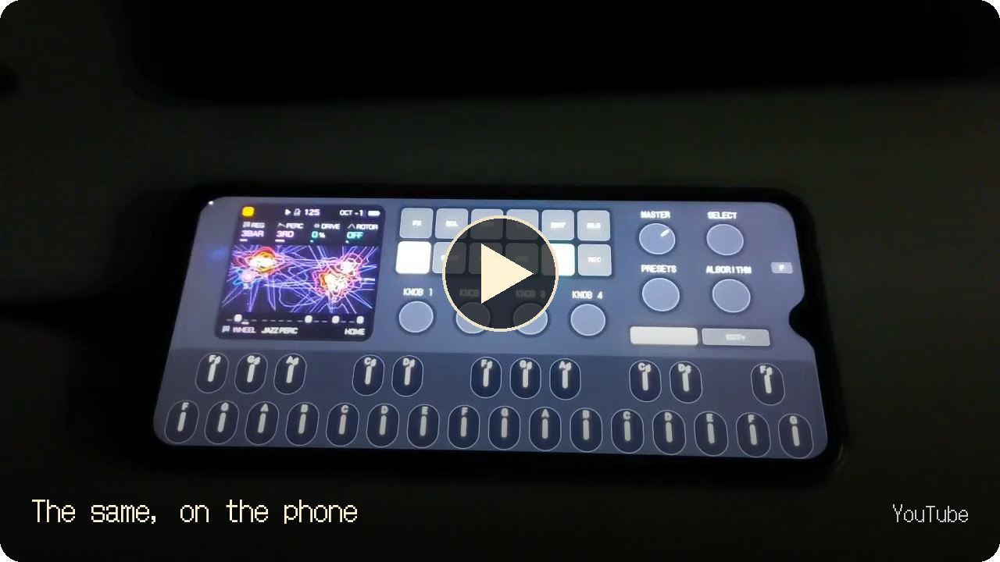](https://youtu.be/3TPQnUw-PsU) |
| **[JIANT FM live on an Android phone](https://youtu.be/nUwRVQZXRtA)** — a jam, straight from the screen | **[FM-1 firmwares as a groovebox on Android](https://youtu.be/3TPQnUw-PsU)** — the same, filmed on the phone |

## Why this exists

Android has very few grooveboxes, and almost none with a character of their own. The FM-1 firmwares have one:
a few buttons that open whole layers, keys that double as a control surface, songs built without a computer, a
little screen that tells you everything. I'm just a groovebox lover who wanted to play them anywhere — on the bus,
on the couch, without the keyboard in my bag.

So here it is, open source. Play it, fork it, grow it.

## Quick start — your first five minutes

1. **Install and open.** The app starts in landscape with the panel and a firmware already running. Turn the phone
   volume up; drag **MASTER** (top-left knob) up for more.
2. **Play.** Touch the keys at the bottom — the lower row is F G A B C D E…, the upper row the sharps. Chords work.
3. **Press PLAY/STOP.** The firmware's sequencer runs its current pattern. Press it again to stop.
4. **Open a layer.** Hold **GLO** (or FX, EDIT, SEQ…): the screen shows that layer's page, and the keys it offers
   light up with their letters — the screen says *F SOLO*, the lit **F** key is solo. Let go to close.
   With the phone in both hands, tap **F** first, then GLO — it stays open until you tap F again.
5. **Turn the knobs.** KNOB 1–4 edit what the screen shows; SELECT, PRESETS and ALGORITHM browse. Drag up/down.
6. **Change the sound.** Turn **PRESETS** for another sound; **OCT− / OCT+** shift the keyboard.
7. **Open Settings** — the small dot in the top-left corner. Try another **Firmware**, another **Skin**, a
   **Master** preset (Loud, Warm, Crush…).
8. **Jam with a friend.** Both phones on the same Wi-Fi → Settings → **MIDI → LINK ON** on both → PLAY on either.

From there, each firmware's own manual opens its world: [Felucca](https://github.com/hugelton/Felucca) ·
[JIANT FM](https://github.com/juanjiant-bit/JIANT/blob/main/docs/MANUAL.md) · [SLOOP](https://github.com/isod89/sloop-fm1).

## Where is what

<p align="center"></p>

| On the panel | What it is | What for |
|---|---|---|
| **Screen** (240×240) | The firmware's own display | Every page, value and hint of the firmware |
| **MASTER** | Volume pot | Output level, like the hardware's |
| **SELECT · PRESETS · ALGORITHM** | Endless encoders | Browse pages, sounds, FM algorithms (the firmware decides) |
| **KNOB 1–4** | Endless encoders | The four values on the current page |
| **FX SCL ENV LFO EDIT GLO** | Layer buttons (top row) | Hold to open a layer; the keys become its functions |
| **HOME SAVE ARP SEQ PLAY REC** | Buttons (bottom row) | Home page, save/load, arpeggiator, sequencer, transport, record |
| **OCT− / OCT+** | Octave buttons, own island | Keyboard octave, and the firmware's combos |
| **F** | Latch (app) | Keeps the next buttons held until you tap them or F again |
| **27 keys** F3–G5 | Keyboard with note names | Notes; in a layer, functions — the lit letters |
| **Dot, top-left** | Settings (app) | Skin, Firmware, Audio, Master, MIDI/Link, About; green while Link is on |

| In Settings | What for |
|---|---|
| **Skin** | Choose one of six layouts; keyboard height, knob sensitivity, fine mode, glissando, haptics |
| **Firmware** | Switch between JIANT FM, Felucca and SLOOP (each keeps its own projects) |
| **Audio** | Master-bus quality ×1–×8; stream, latency and CPU — check here if you hear crackles |
| **Master** | The mastering chain: presets, A/B, bypass, the scope that shows peaks being pressed |
| **MIDI** | Ableton Link — play in sync with other phones and apps |
| **About** | Versions, credits, licences |

The full manual: **[docs/MANUAL.md](docs/MANUAL.md)**.

## Three firmwares, one panel

<p align="center">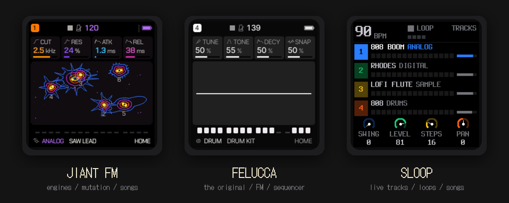</p>

| | Firmware | Its soul | Author |
|---|---|---|---|
| 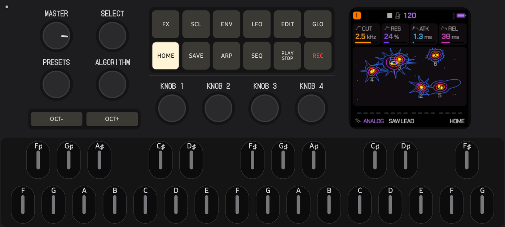 | **JIANT FM** 0.6.41 | A "bio-synthetic operating system": many engines, mutation, songs with ARRANGE and UNDO, made for playing live | [juanjiant-bit](https://github.com/juanjiant-bit/JIANT) |
| 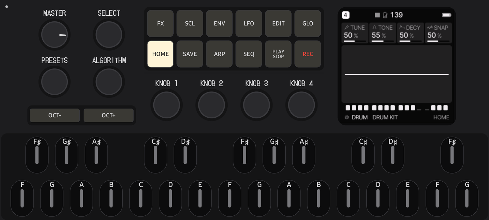 | **Felucca** 1.5.1 | The original alternative firmware: FM voices, a step sequencer with chance and ratchets, MIDI learn, insert effects | [Leo Kuroshita / Hügelton Instruments](https://github.com/hugelton/Felucca) |
| 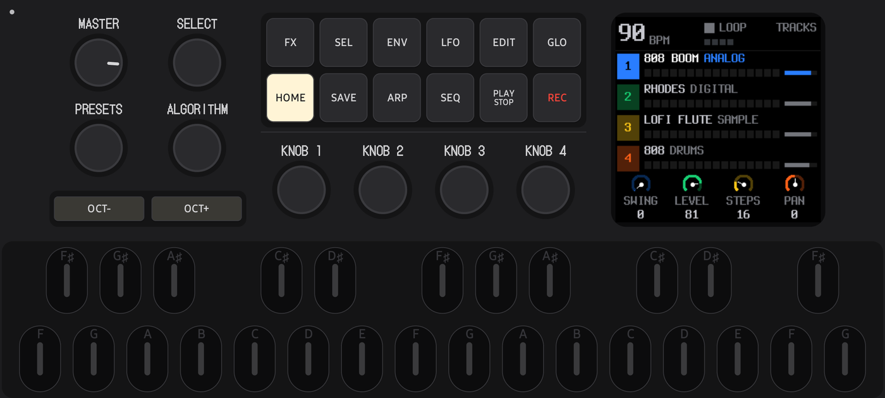 | **SLOOP** 2.6 | A live groovebox for any style: tracks, loops, an arranger, 12 engines | [isod89](https://github.com/isod89/sloop-fm1) |

Switch between them in **Settings → Firmware**. Each keeps its own 1 MB flash — your projects and presets wait for
you when you come back.

## Play it like the hardware

<p align="center">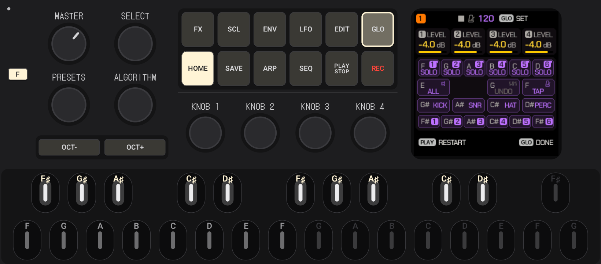</p>

- **The whole FM-1 panel**: the 240×240 screen, 12 buttons with their real LEDs (lit, dim, breathing), SELECT,
  PRESETS, ALGORITHM, KNOB 1–4, MASTER, OCT−/OCT+, 27 keys from F3 to G5.
- **Multitouch** like on the device: hold a layer button with one finger, press keys with the others, play chords.
- **Note names on the keys.** The firmwares' screens name keys by their notes — *F SOLO*, *C ALL*, *G UNDO*. Those
  letters light up on the keys the moment the firmware offers them, so the hint on the screen points straight at
  the key. While you play, the letters glow with the LEDs.
- **F — latch.** Holding a phone with two hands, you have no finger left to hold GLO *and* turn a knob. Tap **F**,
  tap GLO: it stays held until you let it go. One thumb, the whole layer.
- **Knobs that feel right**: drag up or down, fine steps on hold, a glow while you touch.

## Six layouts

The same controls in six arrangements — pick the one that fits your hands. The keyboard always spans the full width.

| | | |
|---|---|---|
|  **Classic** | 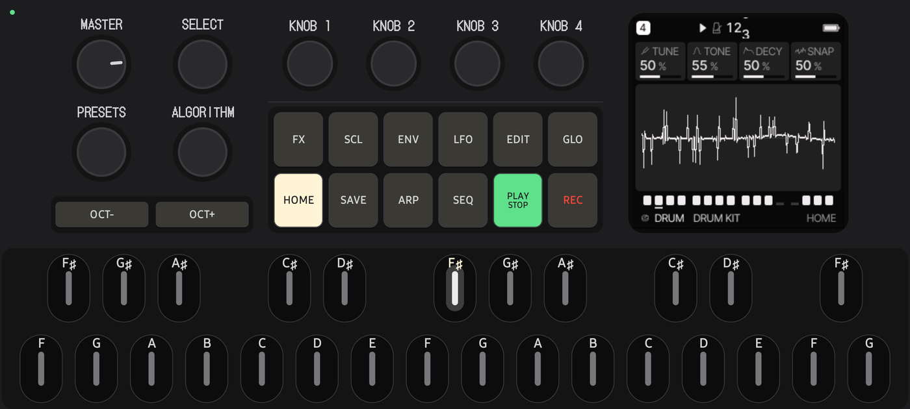 **Knobs on top** | 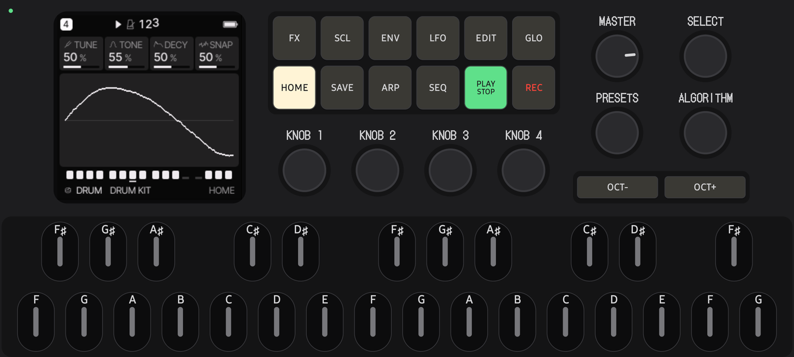 **Screen left** |
| 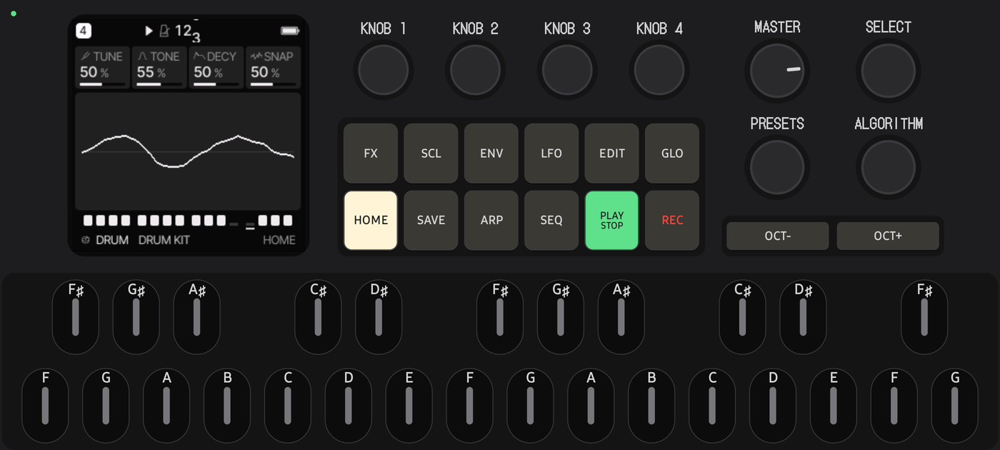 **Screen left, knobs on top** | 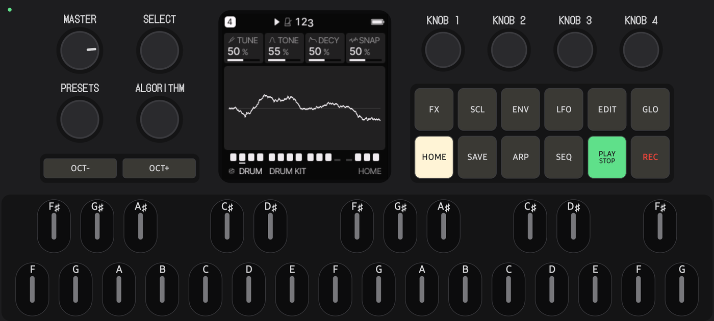 **Screen in the middle** | 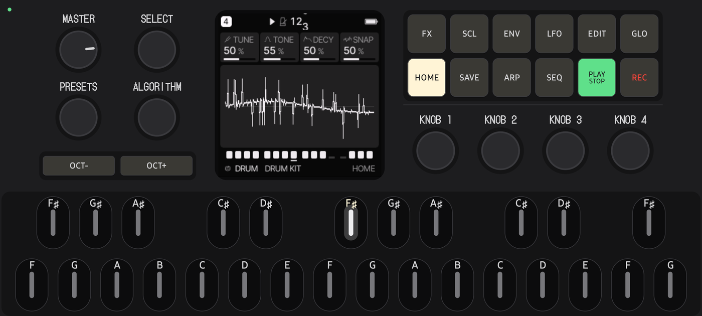 **Screen in the middle, buttons on top** |

Each one is a small JSON file — [write your own](app/src/main/assets/skins/_schema.md) and import it.

## Two phones, one groove — Ableton Link

<p align="center"></p>

Put two phones on the same Wi-Fi, switch **LINK** on both, press **PLAY** on either one — both start together on
the next bar. Change the tempo on one, the other follows. No leader, no cables, no setup. It is
[Ableton Link](https://www.ableton.com/link/), so the same works with Ableton Live and hundreds of music apps.

Under the hood the session becomes a MIDI clock for the firmware, exactly as if a clock cable were plugged into the
FM-1 — compensated for each phone's own audio latency (13 ms on one test phone, 92 ms on the other).

## A master bus with a view

<p align="center"></p>

The firmware's sound goes through a mastering chain of its own:

**dynamic saturation** (drive that follows the level) → **spectral clipper** (multiband, transients returned) →
**look-ahead limiter** (true-peak aware) → **final clipper**.

The scope shows what it does: the signal before in blue, after in cream, gain reduction in red from the top — you
*see* the peaks being pressed. Seven presets (Default, Clean, Warm, Punch, Loud, Crush, Glue) and your own, A/B,
bypass, loudness-matched auto-gain, oversampling ×1–×8.

## Settings at a glance

| | |
|---|---|
|  **Skin** — layouts as schematics, keyboard height, knob feel, haptics |  **Firmware** — Felucca, JIANT FM, SLOOP |
|  **Audio** — quality, stream, latency, CPU budget | 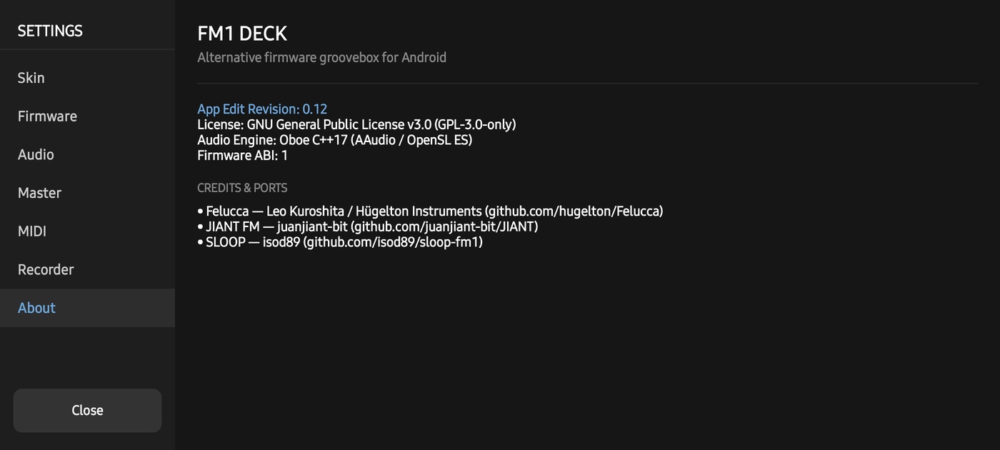 **About** — versions, credits, licences |

Open Settings with the small dot in the top-left corner of the panel (it turns green while Link is on).

## Install

1. Download `FM1-DECK-<version>-arm64.apk` from [Releases](../../releases).
2. Open it on the phone; allow installing from your browser or file manager when Android asks.
3. Android 10 or newer, 64-bit ARM. No permissions at start; the network is used only while Link is on.

Wired headphones or a cable to a speaker work best — Bluetooth adds 150–250 ms of delay.

## How it works

```
 touch panel  ──buttons · keys · knobs──▶  firmware module  ──▶  master bus  ──▶  Oboe / AAudio
 (Compose)    ◀──── screen · LEDs ───────  libfw_<id>.so          SAT · SPEC        48 kHz, low latency
                                           the author's C          LIMIT · CLIP
                                           + its emulator HAL      (oversampled)
                       Ableton Link  ──▶  MIDI clock (24 PPQN, start, stop) into the firmware
```

Every FM-1 firmware ships a browser emulator whose hardware layer models the device — clock, audio buffers, button
matrix, LEDs, LCD, flash. FM1 DECK compiles that same layer with the firmware sources into a native Android module
and drives it from the audio thread, sub-block by sub-block, with the hardware's input timing. Nothing in the
firmware is patched; updating to a new version of a firmware is a rebuild.

More: **[How it works](docs/HOW-IT-WORKS.md)** · the full design documents (in Russian) in [docs/](docs/README.md).

## Build from source

```bash
git clone --recursive https://github.com/TonalPAK/FM1-DECK.git
cd FM1-DECK
python3 tools/fwgen/fwgen.py all            # the firmwares' generated fonts and tables
./gradlew assembleDebug -Pfm1deckAbis=arm64-v8a
```

Needs Android Studio (JDK 21), NDK 28, CMake 3.22+, Python 3 with Pillow, numpy and fonttools (on Windows, run the
`fwgen` step in WSL). Tests: `./gradlew test` and [`native-tests/`](native-tests). Releasing a signed APK:
[docs/RELEASING.md](docs/RELEASING.md). Want to help? [CONTRIBUTING.md](CONTRIBUTING.md).

<details>
<summary><b>Project layout</b></summary>

```
app/                     Android app: Kotlin + Jetpack Compose UI, C++17 engine
  src/main/cpp/fw/       firmware host — Fm1FirmwareApi.h (ABI 1), FirmwareSlot
  src/main/cpp/dsp/      master bus
  src/main/cpp/engine/   Oboe engine, Ableton Link → MIDI clock
  src/main/assets/skins/ six layouts, palettes
fwbuild/                 builds each firmware into libfw_<id>.so (glue, profiles, SLOOP's host HAL)
upstream/                Felucca, JIANT, SLOOP — submodules, never edited
third_party/link/        Ableton Link
native-tests/            C++ tests (DSP, clock, firmware slot)
docs/                    manual, how it works, design docs, screenshots
```
</details>

## Roadmap

- [x] Felucca, JIANT FM, SLOOP on the phone, switchable, each with its own flash
- [x] The full panel, six layouts, note names, F latch
- [x] Master bus with scope, presets, A/B
- [x] Ableton Link: tempo, phase, start/stop
- [ ] Firmware updates from a file, flash backups *(planned)*
- [ ] Hints on keys and knobs for every layer *(planned)*
- [ ] Recorder: WAV of what you play *(planned)*
- [ ] USB / Bluetooth MIDI, network MIDI notes between phones *(planned)*
- [ ] Sync calibration by microphone *(planned)*

## Credits

FM1 DECK only gives these firmwares a new home — all the music-making inside is their authors' work. If you enjoy
them, go star their repositories and support them:

- **Felucca** — Leo Kuroshita (@kurogedelic), Hügelton Instruments · [hugelton/Felucca](https://github.com/hugelton/Felucca)
- **JIANT FM** — juanjiant-bit · [juanjiant-bit/JIANT](https://github.com/juanjiant-bit/JIANT) · [Ko-fi](https://ko-fi.com/juanjiant)
- **SLOOP** — isod89 · [isod89/sloop-fm1](https://github.com/isod89/sloop-fm1)
- **Ableton Link** — Ableton AG · **Oboe** — Google · **DotGothic16** font — The DotGothic16 Project Authors

All third-party components and their licences: [THIRD_PARTY_LICENSES.md](THIRD_PARTY_LICENSES.md).

FM1 DECK is an independent fan project, not affiliated with or endorsed by the maker of the FM-1 or by the firmware
authors. "FM-1" names the hardware these firmwares were written for; trademarks belong to their owners.

## License

[GPL-3.0-only](LICENSE), like the firmwares it runs. Use it, study it, change it, share it — and keep it open.
