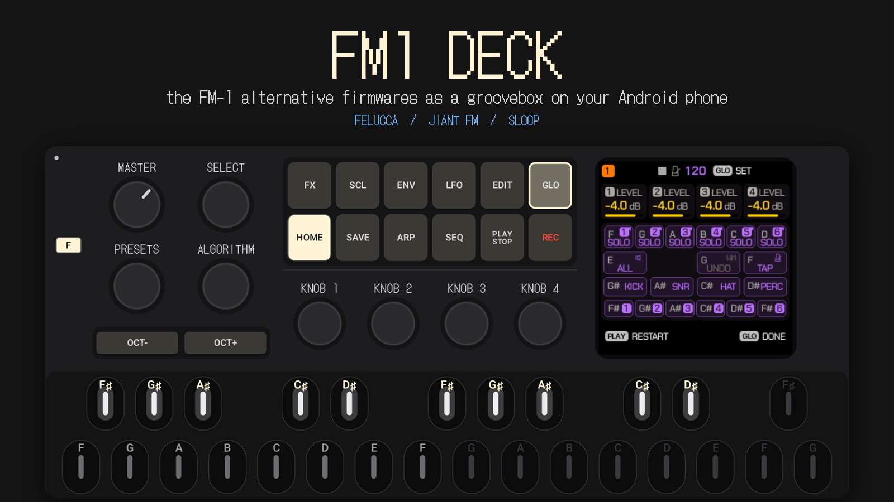
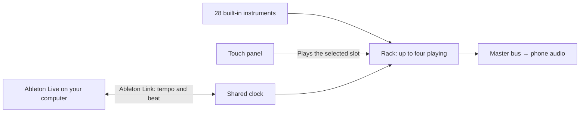
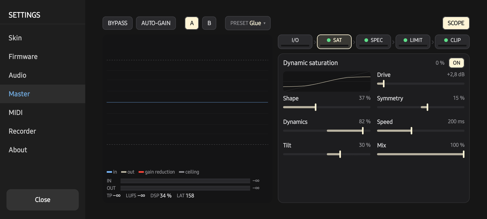

# FM1 DECK

**An Android groovebox with 28 built-in instruments and a four-slot live rack.**

Play a wavetable synth, a drum machine, an acid bassline or a granular sampler on the same touch panel. Pick any
four different instruments from the library, play them together and save the setup as a session. The app runs
standalone on the phone and can share its tempo and beat with **Ableton Live** over Wi-Fi.

[Download the latest signed APK](https://github.com/TonalPAK/FM1-DECK/releases/latest) ·
[Preview builds from main](https://github.com/TonalPAK/FM1-DECK/actions/workflows/android.yml?query=branch%3Amain) ·
[Changelog](CHANGELOG.md)



> **По-русски.** FM1 DECK превращает Android-телефон в грувбокс. В APK уже есть 28 музыкальных прошивок.
> Выбираешь до четырёх для рэка, переключаешь панель между ними, а остальные слоты продолжают играть.
> Для игры на телефоне Wi-Fi не нужен. Ableton Link нужен, когда хочется играть в одном темпе с Ableton Live или
> другим устройством в той же сети.

## 28 in the library, up to four playing

In FM1 DECK, a **firmware** is a complete instrument with its own sound engine, presets, display and controls.
Most come from the community around the FM-1 pocket synthesizer. SHRUB is adapted from its WebAssembly build.
FM1 DECK runs each instrument as a module inside the Android app. You install one APK and pick instruments
from its library on the phone.



For example, put **Hortator** on drums, **ATEK303** on bass and **SHRUB** on the lead. Add **ECHOFIELD** for texture
or leave the fourth slot empty. All the active slots mix to the phone's stereo output. The selected slot gets the
keys, knobs and buttons, and its display appears on the panel. Each slot has a level, mute and solo. With two or
more slots, the rack provides a shared clock even offline. Settings → **Session** saves the slot choices, levels,
mute and solo, tempo and each loaded instrument's saved state.

## Start playing

1. Install the signed APK from **Releases** on an Android 10+ phone with a 64-bit ARM processor. For a preview build,
   sign in to GitHub, download the `app-debug` Actions artifact and unzip it to get `app-debug.apk`.
2. Open the app and play the keys. **PRESETS** changes the sound, **OCT− / OCT+** moves the keyboard, and
   **KNOB 1–4** edits the current page. The screen comes from the selected instrument. Knob captions follow the
   current page on ports that provide parameter data.
3. Tap the **triangle at the top right** to open the rack. Use a slot's arrow to choose an instrument, then tap the
   slot to put it on the panel. **M** mutes and **S** solos.
4. With two or more slots, drag the rack's **BPM** to set the tempo and tap its transport to start or stop the
   instruments that follow it. Load or record a pattern in an instrument if its sequencer has nothing to play.
5. Tap the **white ring at the top left** for Settings. Try a **Skin**, adjust the **Master** chain or save your setup
   under **Session**. Watch the DSP meter if several instruments cause crackles.

[Watch a JIANT FM jam on the phone](https://youtu.be/nUwRVQZXRtA) ·
[See the touch controls in action](https://youtu.be/3TPQnUw-PsU) ·
[Read the panel manual](docs/MANUAL.md)

## Play alongside Ableton Live

1. Put the phone and the computer running **Ableton Live** on the same local network.
2. On the phone choose **Settings → MIDI → LINK ON**. In Live, turn on **Link**. Check the peer count on the phone.
3. Set the tempo from either device. To share PLAY and STOP too, enable **Start Stop Sync** in Live and use the
   rack transport on the phone.

FM1 DECK uses Link for musical timing. The phone plays its own audio, and recording that sound in Live requires a
separate audio connection. Link here carries no audio or MIDI notes. Clock support varies by firmware. Some
instruments need their external clock setting enabled, and a few keep their own transport. SHRUB takes the rack's
BPM directly and keeps the preset tempo for standalone use.

[FM1 DECK sync guide](docs/LINK.md) ·
[Ableton Live Link setup](https://www.ableton.com/en/live-manual/12/synchronizing-with-link-tempo-follower-and-midi/)

## What's in the library

| What you want to play | Built-in instruments |
|---|---|
| Sequences, songs and full arrangements | Felucca, JIANT FM, SLOOP, LOOM-8, Ravel, JAMTRACK |
| Wavetables, analog-style voices and strings | SHRUB, FMini-1, Guru-600, OberVave, S1Vave, Clipper, Shine On |
| Drums, breaks and bass | Hortator, CHOPPAH, LOAF BREAKER, ATEK303, K-WASUB |
| Chords and tuned percussion | CoralFlower, Blop, FiMba-1 |
| Ambient, granular and generative textures | Mutable Dreams, AMB-1, FRASIL, AISLING, ECHOFIELD, Arctic Scream, Demake |

The rack's picker shows each instrument's thumbnail and version. For the authors and source projects, see the
[firmware credits and licences](THIRD_PARTY_LICENSES.md).

## What the phone adds

- A multitouch panel with 27 keys, a 240×240 firmware display, switchable layouts and a latch for held buttons.
- Per-instrument storage for presets and projects, plus sessions that bring the whole rack back.
- A stereo master bus with saturation, spectral clipping, a look-ahead limiter and a final clipper. The Master
  tab shows the effect on the signal and offers presets, A/B and bypass.



## Build from source

```bash
git clone --recursive https://github.com/TonalPAK/FM1-DECK.git
cd FM1-DECK
python3 tools/fwgen/fwgen.py all
./gradlew assembleDebug -Pfm1deckAbis=arm64-v8a --no-daemon
```

Use JDK 21, Android SDK and NDK 28.2, CMake, Ninja and Python with Pillow (RAQM), NumPy and fontTools. On Windows,
use WSL for firmware header generation and `gradlew.bat` for the Android build. The APK is written to
`app/build/outputs/apk/debug/app-debug.apk`. Remove the ABI override to build ARM64 and x86_64. GitHub Actions runs
`assembleDebug`, the host tests and the native suite on pushes to `main` and on pull requests into `main`.
The `app-debug` artifact is published on pushes to `main`.

The Android host uses the firmware's original sources where available, with adapters for the hardware interface.
Each module has its own audio and persistent state. The phone loads the modules it needs, renders them into the
rack and sends the mix to Android through Oboe.

[Architecture](docs/ARCHITECTURE.md) · [Firmware module build](fwbuild/README.md) · [Testing](docs/TESTING.md) ·
[Contributing](CONTRIBUTING.md)

## Credits and licence

FM1 DECK is an independent project. The instruments are the work of their respective firmware authors. The app is
licensed under [GPL-3.0-only](LICENSE). Firmware, assets and other third-party components have their own terms,
listed in [THIRD_PARTY_LICENSES.md](THIRD_PARTY_LICENSES.md).
