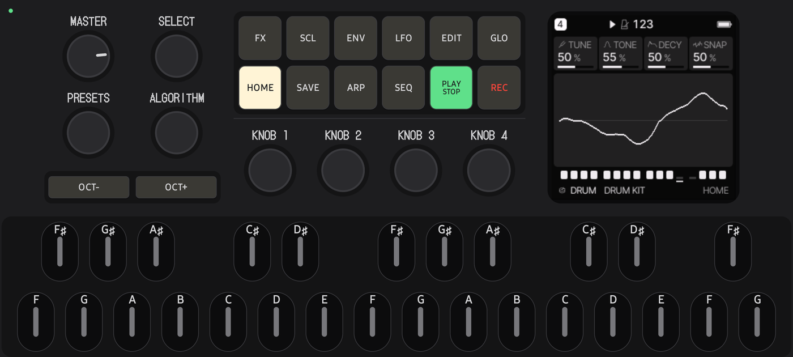
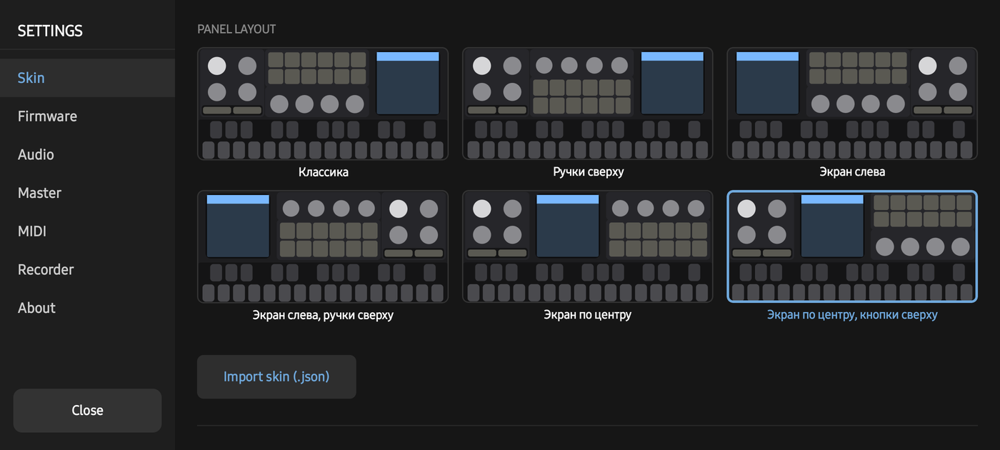
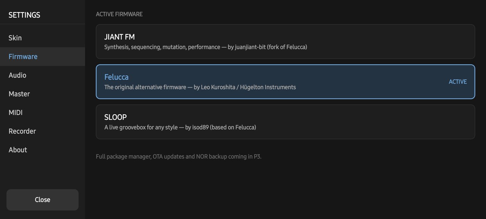
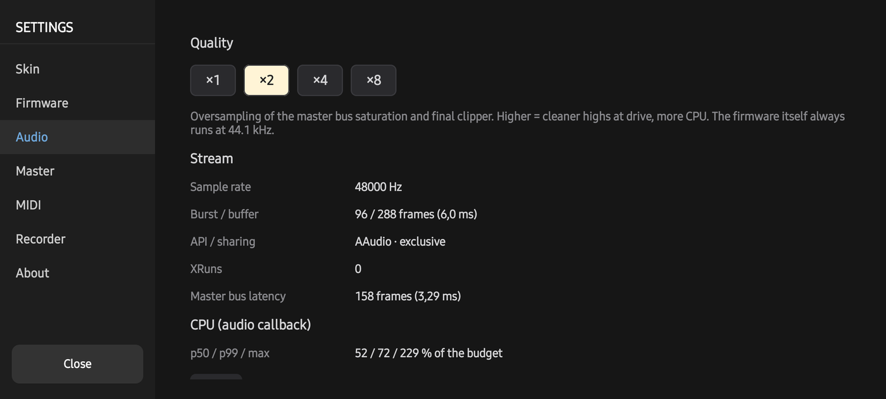
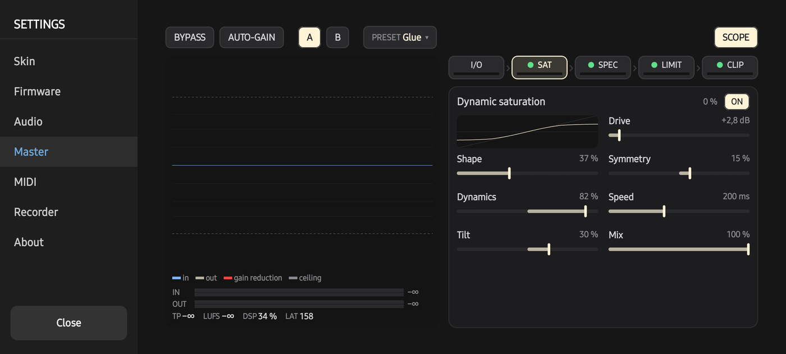
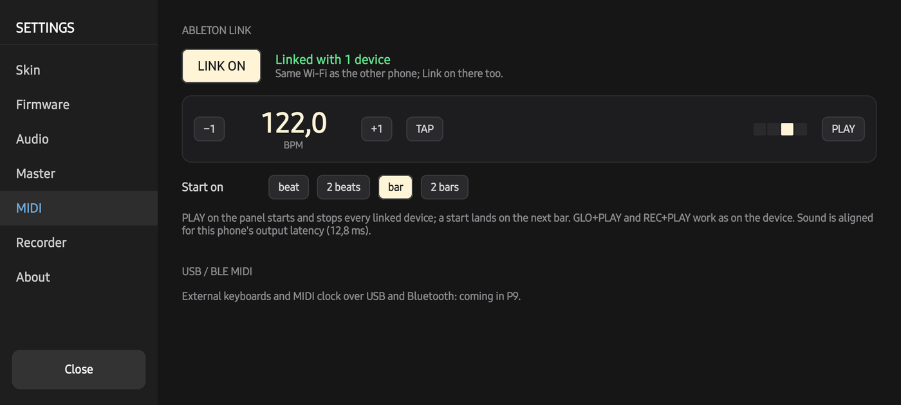

# FM1 DECK — Manual

FM1 DECK plays the FM-1 alternative firmwares on an Android phone. This manual covers the app: the panel, the
layouts and the settings. What each firmware does with its buttons, keys and pages is in its own manual:

- **Felucca** — [github.com/hugelton/Felucca](https://github.com/hugelton/Felucca)
- **JIANT FM** — [docs/MANUAL.md](https://github.com/juanjiant-bit/JIANT/blob/main/docs/MANUAL.md) and its cheat sheets
- **SLOOP** — [github.com/isod89/sloop-fm1](https://github.com/isod89/sloop-fm1)
- **Hortator** — [github.com/DeadActive/hortator](https://github.com/DeadActive/hortator)

Everything those manuals say about the hardware's panel applies here: the app's panel is the same panel.

## 1. The panel

| Control | How to use it |
|---|---|
| **Screen** | The firmware's own 240×240 display, exactly as on the hardware. |
| **12 buttons** (FX, SCL, ENV, LFO, EDIT, GLO / HOME, SAVE, ARP, SEQ, PLAY/STOP, REC) | Tap or hold. Their light is the firmware's LED: lit, dim, breathing. A held button is outlined. |
| **SELECT, PRESETS, ALGORITHM, KNOB 1–4** | Endless encoders: drag up or down on the knob. Hold still for a moment before moving for fine steps (if *Fine mode* is on). |
| **MASTER** | Volume, like the hardware's potentiometer: drag up or down. |
| **OCT− / OCT+** | Octave, and every combo the firmware gives them. |
| **27 keys** (F3–G5) | Bottom row: naturals; top row: sharps. Multitouch: play chords, hold a layer button with one finger and press keys with others. |
| **F (latch)** | The mini button in the margin beside the MASTER / PRESETS knobs. Tap F (it lights), then tap buttons: each stays held until you tap it again or tap F to release everything. Handy with the phone in both hands: latch GLO, FX or EDIT and turn an encoder with the same thumb. Without F everything works as usual. |
| **Note names** | Each key shows its note. When the firmware offers keys as functions (a layer is held, the screen says "F SOLO", "C ALL"), those letters light up brightly; while you play they glow with the key's LED. |
| **Settings dot** | The small dot in the top-left corner opens Settings. It is green while Ableton Link is on. |

## 2. Settings → Skin

- **Panel layout** — six arrangements of the same controls. Each thumbnail is a schematic of the real layout:
  circles are knobs (the bright one is MASTER), the grid is the buttons, the blue square is the screen.
- **Keyboard height** — how much of the screen the keys take.
- **Knob sensitivity** — finger travel per encoder step.
- **Fine mode on knob hold**, **key glissando** (slide between keys), **pixelated screen scaling**, **haptic feedback**.
- **Import skin (.json)** — your own layout (format: [app/src/main/assets/skins/_schema.md](../app/src/main/assets/skins/_schema.md)).

## 3. Settings → Firmware

Pick Felucca, JIANT FM, SLOOP or Hortator. Each has its own flash memory (projects, presets, settings), saved when you switch
and restored when you come back. *Planned:* installing newer firmware versions from a file, backups.

## 4. Settings → Audio

- **Quality ×1 / ×2 / ×4 / ×8** — oversampling of the master bus's saturation and final clipper. Higher is cleaner
  at high drive and costs more CPU. Default ×2. The firmware itself always runs at its native 44.1 kHz.
- **Stream** — sample rate, buffer, whether the phone gave the app exclusive low-latency output, underruns (XRuns),
  the master bus's latency.
- **CPU** — how much of each audio callback's time budget is used (median, 99th percentile, maximum).

## 5. Settings → Master

The master bus processes the firmware's output; the firmware's sound is not changed inside.

- **Top row:** BYPASS, AUTO-GAIN (matches loudness so A/B is fair), A / B (two snapshots), PRESET menu (Default,
  Clean, Warm, Punch, Loud, Crush, Glue, your own; *save as…*), SCOPE (switches the animation off).
- **Left — the scope:** the last ~2 seconds. Blue outline: the signal before; cream: after; red from the top: gain
  reduction; dashed: the ceiling. Where the blue rises above the cream, peaks were pressed down. Below: peak meters,
  true peak, short-term LUFS, CPU share, latency.
- **Right — the chain** `I/O › SAT › SPEC › LIMIT › CLIP`. Tap a stage to open it; the green dot shows it is on, the
  bar under it shows how much it works right now. Controls are thin faders: drag anywhere (it never jumps), double
  tap for the default. ON/OFF switches the stage.
  - **SAT** — dynamic saturation (drive follows the level), with its transfer curve and live operating point.
  - **SPEC** — a multiband clipper that returns transients.
  - **LIMIT** — look-ahead limiter, true-peak aware.
  - **CLIP** — final clipper, before or after the limiter.

## 6. Settings → MIDI: Ableton Link

Play two phones together (or a phone with Ableton Live or any Link app) on the same Wi-Fi.

1. **LINK ON** on each device. "Linked with N devices" means they found each other.
2. **PLAY** on any phone's panel starts all of them on the next boundary chosen in **Start on** (beat, 2 beats,
   bar, 2 bars); PLAY again stops all. Combos (GLO+PLAY, REC+PLAY…) stay local.
3. **Tempo:** −1 / +1, TAP, or drag the number. Any device can change it; there is no leader.

The firmware follows Link as an external MIDI clock. The app compensates each phone's own output latency. Link is
off at every launch; the network is used only while it is on.

*Planned:* USB and Bluetooth MIDI (keyboards, clock), network MIDI notes between phones.

## 7. Recorder

*Planned:* record the output to WAV.

## 8. Tips

- Use headphones or a speaker with a cable: Bluetooth adds 150–250 ms of delay.
- If you hear crackles, lower Quality (Settings → Audio) and close other apps.
- Back up nothing yet? Each firmware's projects live in the app's storage; uninstalling the app deletes them.
